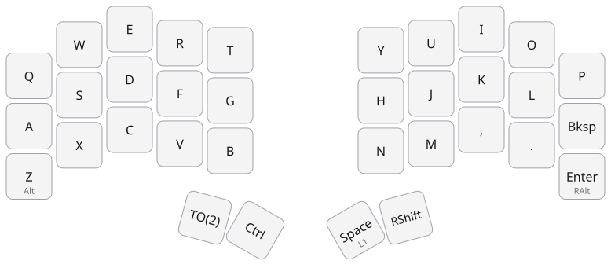
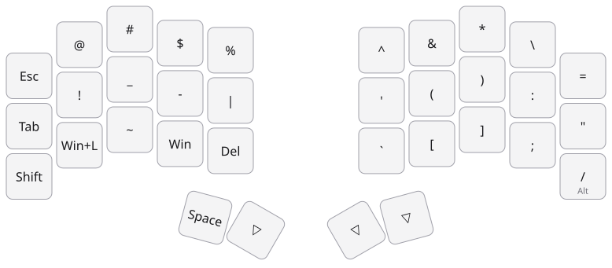
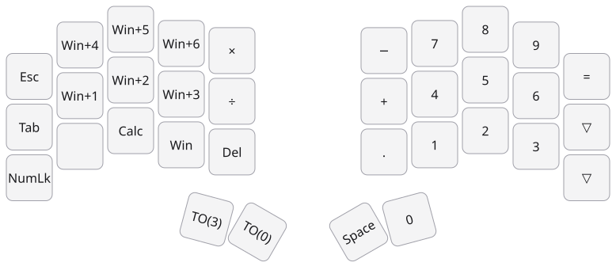
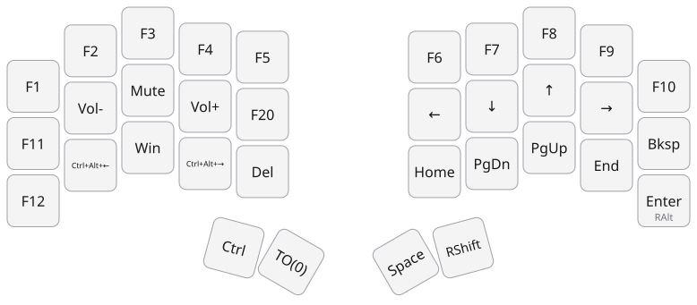

# ferris-layer

Shows the active layer of a [Ferris Sweep](https://github.com/davidphilipbarr/Sweep) running QMK as a coloured icon in the GNOME top bar.


Keyboard layers only exist inside the firmware: the computer just receives the final keys. This project adds a tiny piece of firmware that tells the computer which layer is active, and a small desktop app that turns that into a tray icon.

## How it works

```
 Ferris Sweep (QMK + VIA)                         Ubuntu / GNOME
┌─────────────────────────┐    Raw HID     ┌──────────────────────────────┐
│ layer_state_set_user()  │ ── "LY" + n ─▶ │ ferris-layer (systemd --user)│
│ via_command_kb()        │ ◀─ "LY" ────── │  reads /dev/hidrawN          │
└─────────────────────────┘                │  updates the top bar icon    │
                                           └──────────────────────────────┘
```

- On every layer change the firmware sends a 32-byte Raw HID report: `'L' 'Y' <layer>`.
- When the app connects it sends `'L' 'Y'` and the firmware answers with the current layer, so the icon is right from the start.
- VIA keeps working: the reports share the VIA Raw HID channel and use a prefix that no VIA command uses.
- If the keyboard is unplugged the app waits and reconnects on its own.

## Requirements

- Ubuntu (or another Debian-based distro) with GNOME. Tested on Ubuntu 24.04 on X11.
- A Ferris Sweep with QMK. The build script defaults to a Pro Micro RP2040 and supports any QMK converter (`elite_pi`, `kb2040`, `sparkfun_pm2040`…).
- [uv](https://docs.astral.sh/uv/getting-started/installation/) and Docker (to build the firmware).

## Install the desktop app

```sh
git clone https://github.com/quiqueporta/ferris-layer.git
cd ferris-layer
./install.sh
```

`install.sh`:

1. Installs the system packages it needs: `python3-gi`, `gir1.2-gtk-3.0`, `gir1.2-ayatanaappindicator3-0.1` and `gnome-shell-extension-appindicator`.
2. Creates a virtualenv with uv on the system Python with `--system-site-packages`. GTK bindings are much easier to get from apt than to build from PyPI.
3. Installs a udev rule so your user can read the keyboard's `/dev/hidraw` device without root.
4. Copies `config.example.toml` to `~/.config/ferris-layer/config.toml`.
5. Installs and starts the `ferris-layer` systemd user service.

On Ubuntu the AppIndicator extension is enabled by default. On other GNOME distros enable it with `gnome-extensions enable appindicatorsupport@rgcjonas.gmail.com`.

### Layer names

The icon menu shows the layer name. Edit `~/.config/ferris-layer/config.toml`:

```toml
[layers]
0 = "Letters"
1 = "Symbols"
2 = "Numbers"
3 = "Functions"
```

Layers without a name are shown as `Layer N`. Restart the service after editing: `systemctl --user restart ferris-layer`.

## Firmware

### 1. Back up your VIA configuration

Flashing a new VIA firmware usually wipes the keymap and macros stored in the keyboard's EEPROM. Save them first:

```sh
uv run ferris-via-backup save my-backup.json
```

### 2. Create your keymap

Generate a QMK keymap from the backup. It boots with exactly your current layout, and the layer report is already wired in:

```sh
mkdir -p firmware/keymaps/myname
uv run ferris-via-backup keymap my-backup.json > firmware/keymaps/myname/keymap.c
cp firmware/keymaps/quique/rules.mk firmware/keymaps/myname/
```

If you already have your own QMK keymap, add the files from `firmware/layer_report/` to it and add these lines:

```c
#include "layer_report.h"

layer_state_t layer_state_set_user(layer_state_t state) {
    layer_report_announce(state);

    return state;
}

bool via_command_kb(uint8_t *data, uint8_t length) {
    return layer_report_answer(data);
}
```

```make
# rules.mk
VIA_ENABLE = yes
SRC += layer_report.c
```

### 3. Build

Clone QMK once, then build inside the official QMK Docker image:

```sh
git clone --depth 1 --recurse-submodules --shallow-submodules https://github.com/qmk/qmk_firmware.git ~/qmk_firmware
firmware/build.sh myname promicro_rp2040
```

The firmware ends up in `firmware/build/`. Set `QMK_HOME` if QMK lives somewhere else.

### 4. Flash both halves

Flash both halves with the same firmware, so they keep understanding each other over the TRRS cable. For each half, on its own:

1. Unplug the USB and TRRS cables.
2. Hold the outer top key (`Q` on the left half, `P` on the right half) while plugging the USB cable into that half. This is QMK bootmagic and it puts the board into its bootloader.
3. A drive called `RPI-RP2` appears. Copy the `.uf2` file to it and the board reboots.

### 5. Restore your macros

The keymap is already in the firmware, but macros only live in the backup:

```sh
uv run ferris-via-backup restore my-backup.json
```

### 6. Keep using VIA

You only need QMK to build and flash the firmware. Day-to-day changes to keys and macros are still made in [VIA](https://usevia.app), with no rebuild.

- `keymap.c` is only the starting layout: the one the keyboard has right after flashing or after its EEPROM is reset. Whatever you change in VIA is stored in the EEPROM and takes precedence over it.
- After significant changes in VIA, save a fresh backup so nothing is lost the next time you flash:

  ```sh
  uv run ferris-via-backup save my-backup.json
  ```

## Layer images

Draw every layer of a VIA backup as an SVG image, with the Sweep's shape:

```sh
uv run ferris-via-backup images my-backup.json docs/layers
```

Each key shows what it types. Keys that do something else when held show it underneath (`Alt`, `L1`), and macros show what they do (`Win+L`, `Ctrl+Alt+←`) instead of `M0`. Labels assume a US layout, as VIA does.

Save a fresh backup first, so the images match what the keyboard has now.

## Example: the author's layout

`firmware/keymaps/quique/` holds the author's keymap, and `docs/layers/` its images, both generated from `via-backup.json` in the same folder.

| Layer | Name | |
| --- | --- | --- |
| 0 | Letters |  |
| 1 | Symbols (hold `Space`) |  |
| 2 | Numbers (`TO(2)`) |  |
| 3 | Functions (`TO(3)`) |  |

## Development

```sh
uv venv --python /usr/bin/python3 --system-site-packages
uv sync
uv run pytest
uv run ferris-layer
```

| Module | Role |
| --- | --- |
| `layer_watcher` | Turns keyboard reports into layers to display. |
| `layer_report` | Knows the `LY` report format. |
| `keyboard_connection` | Finds the keyboard, asks for its layer, reconnects when unplugged. |
| `hidraw_finder`, `hidraw_keyboard` | Talk to `/dev/hidraw`. |
| `tray_indicator_display`, `layer_icons` | Draw the top bar icon. |
| `via_protocol`, `via_backup`, `keymap_source` | VIA backup, restore and keymap generation. |
| `via_keymap`, `via_macros` | Read the keymap and macros stored in a VIA backup. |
| `keycode_labels` | Turns QMK keycodes into keycap labels. |
| `layer_images`, `layer_drawing`, `sweep_layout` | Draw each layer as an SVG image. |

## License

[MIT](LICENSE). The firmware you build links against QMK, which is GPL-2.0-or-later.
